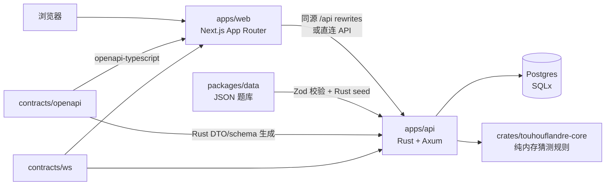
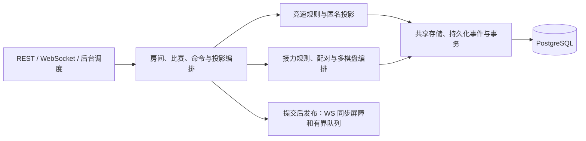
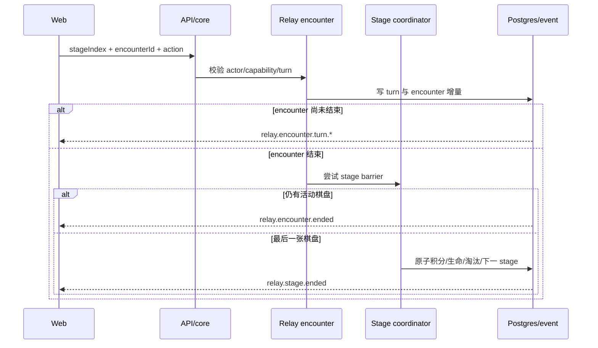
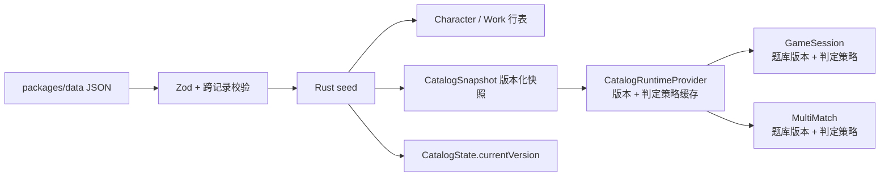
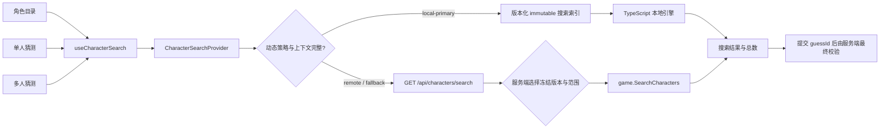
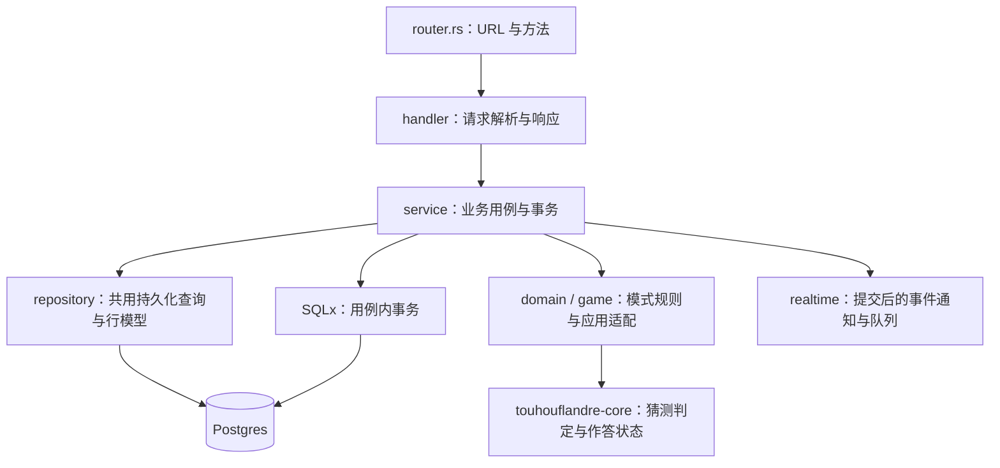

# 架构说明

本文说明 TouhouFlandre 的技术架构、数据流和长期维护约束。

## 总览

## 技术栈

| 层级     | 技术                                                         | 用途                                         |
| -------- | ------------------------------------------------------------ | -------------------------------------------- |
| 前端     | Next.js 16 App Router、React 19、TypeScript、Tailwind CSS v4 | 页面路由、交互组件、样式系统。               |
| 前端数据 | openapi-fetch、openapi-typescript、Dexie                     | 类型化 API 调用、IndexedDB 本地统计。        |
| 后端     | Rust 1.99、Tokio、Axum WebSocket、SQLx                       | HTTP API、权威游戏规则、多人实时通道。       |
| 数据库   | Postgres 18、SQLx 内嵌迁移                                     | 题库、会话、每日题、多人房间和事件。         |
| 契约     | OpenAPI、WebSocket protocol YAML                             | HTTP 与实时事件协议。                        |
| 测试     | Vitest、React Testing Library、Playwright、cargo test           | 单元、组件、端到端和真实 Postgres 集成测试。 |
| 部署     | Docker、Docker Compose、Next standalone、distroless Rust 镜像  | 生产全栈部署。                               |

## 契约优先

`contracts/openapi/openapi.yaml` 是 HTTP API 契约唯一入口。Rust 侧从同一 OpenAPI 生成 serde DTO 与 JSON 校验 schema，Axum handler 通过统一验证入口检查请求，前端通过 openapi-typescript 生成类型并使用 openapi-fetch 调用。

生成物提交入库，CI 通过重新生成和 `git diff --exit-code` 防止漂移。生成目录不得手工编辑：

- `apps/api/src/contracts/generated.rs`、`schemas.json`、`operations.json`
- `apps/web/src/generated`

WebSocket 事件协议记录在 `contracts/ws/protocol.yaml`，Rust/TS 类型与协议通过检查脚本保持一致。

## 权威边界

- Rust API 是搜索源数据和范围、答案选择、字段比较、每日题、随机题、会话和多人状态的权威来源；浏览器本地搜索只产生候选项，提交后仍由 API 校验。
- 前端只展示服务端返回状态，不选择答案，不重新计算反馈。`local-primary` 下前端可以对服务端发布的公开版本化索引执行与 Rust 一致的匹配、过滤、排序和分页。
- `packages/shared` 保留前端类型、展示工具、模式配置、题库校验辅助和分享文本；搜索语义由 Rust 实现和跨语言 fixture 冻结，浏览器引擎必须通过同一黄金样例。
- `packages/data` 负责源数据结构校验，seed 后以 Postgres 和题库快照作为运行时读取来源。
- 多人 match 以完整 `RuleSetRef`（`mode + ruleSetKey + ruleSetVersion`）选择权威实现。race 的 `scoringMode`（`wins | points | placement`）只保留为兼容投影；relay 使用 `legacy_wins | fixed_points | elimination`，共享 core 不解析任一模式的计分字段。

## 错误类型与诊断

Rust 后端在 `src/error.rs` 集中维护 `ApiError`、`ErrorCause` 和 HTTP 映射。
`thiserror` 的 `#[from]` / `#[source]` 保留 SQLx、JSON、领域、队列和任务错误，
调用处优先用 `?` 传播；不要把错误转换成字符串或用忽略参数的 `map_err` 返回 500。
已知数据不变量失败使用 `ApiError::invariant`，传入固定的上下文描述。
`GameError`、relay 规则、实时协议的错误使用明确枚举，业务分支匹配变体。
启动、配置和命令行入口允许继续使用 `anyhow` 聚合错误。

HTTP 的状态码、`code`、`error` 仍按现有契约映射；原始原因只保存在服务端。
HTTP 5xx、就绪检查、WebSocket 会话/重放/发布和后台清理统一调用 `report`，
记录操作名称、错误类别链、SQLSTATE 和源代码位置；请求日志只带方法和路由模板。
禁止直接把任意错误的 Display/Debug、SQL 参数、数据库 detail/hint、请求正文、
房间标识或令牌写入这些结构化诊断。普通 HTTP 4xx 不按服务端故障记录。
游标签名、无效控制帧等预期协议拒绝有意不保留可能带输入数据的解析细节。

共享题库缓存需要克隆失败结果，使用 `Arc<SharedSource>` 保留原始叶子错误，
避免 `Arc<E>::source()` 转发时跳过 `E`，并允许失败加载在数据修复后重试。
后台清理会记录每个失败步骤，继续执行独立步骤，并向调用者返回第一个原始错误。

## 多人模式内核

多人共享模型、存储和事件序列位于 `src/repository/{models,multi,events}.rs`；房间生命周期、命令分派、比赛创建和观察者投影由 `src/service/multi` 组合模式实现，HTTP 入口统一位于 `src/handler`。`MULTI_MODE_REGISTRY=full|race-only|relay-only` 保留原配置语义，未知 profile 或缺失/未知的持久化 `RuleSetRef` 明确失败，不能回退到默认规则。生产默认 `full`，发布开关控制新配置，已开始的场次按冻结规则恢复。

`game` 不能依赖数据库或 HTTP 服务；`realtime` 的帧、游标、连接注册和发送队列不能依赖应用状态或数据库。`repository` 不依赖 `service`，race 与 relay 不能互相导入，跨模式调用集中在应用编排层。`domain` 不调用存储、HTTP 或服务适配层，仅允许无 I/O 的行类型映射派生。`pnpm check:multiplayer-boundaries` 扫描 Rust 导入和完全限定路径，并通过负例验证 grouped use、相对路径和别名不能绕过边界。

兼容旧双人 relay 的读取仍保留；删除兼容路径前必须确认所有旧房间与保留期历史已排空，并单独规划契约迁移。

### Relay 数据流

relay match 以 stage 作为统一结算边界，以 encounter 作为独立棋盘，以 turn 记录单次动作。普通 guess/pass 只锁目标 encounter；进入终态时才尝试 stage 屏障，最后一个完成者在 stage 锁内幂等结算，避免四张棋盘被全局锁串行。

Snapshot 只包含当前 stage、standings、紧凑历史摘要和同步水位；已结束 stage 通过分页历史 API 按需读取。进行中答案在 adapter 投影前即被 capability policy 删除，terminal encounter 只揭示自己的答案。事件先持久化再通过 hub 广播，WS v3 的 `room.cursor`、`sync.complete` 与 snapshot 缺口修复保持同一房间 sequence 连续。

## 题库数据流

seed 会在单事务内 upsert 行表、写不可变的版本化快照并更新当前版本。同版本同内容幂等成功，同版本不同内容立即失败。会话、每日题和多人场次同时记录题库版本与答案判定策略，恢复时按冻结值读取快照，因此题库更新或环境配置变化不会改变已开始题局。

`crates/touhouflandre-core` 是六字段规范值、反馈比较和答案等价的权威实现。
`apps/api/src/game/fields.rs` 保留公开字段的标签、类型、可选模式、默认模式和展示值，
通过适配器调用核心规则。`CatalogFull.fieldDefinitions` 驱动前端通用设置界面；对局投影返回冻结的 `activeFields`，棋盘、分享文本和字段数量均读取该列表。QuestionScope schema v3 使用 `fieldModes`，导入层继续读取 v1/v2 固定字段并规范化为 v3；预设缺少新字段时使用注册表默认值，自定义配置缺少字段时隐藏该字段。

`CatalogRuntimeProvider` 按 `catalogVersion + answerMatchPolicy` 缓存不可变角色快照和核心题库，并合并同一键的并发首次加载。`CatalogRuntime` 为单人、竞速和接力适配 `touhouflandre_core::Catalog` 的判定结果。`public_fields_v1` 只对全部等价字段均为已知值的 `enabledAsGuess` 角色分组，多值字段按规范集合比较；本局启用字段和答案池不参与分组。`MatchResult.kind` 区分 `none`、`exact` 与 `equivalent`，终局投影始终保留实际抽中的答案 ID。

## 可复用猜测包

`touhouflandre-core` 接收普通 Rust 值并同步返回语义结果，不加载题库、不执行 I/O，
也不包含名称、头像、中文标签、箭头、玩家身份或房间状态。默认依赖只有 `thiserror`，
`serde` 为可选功能。纯内存使用方式见[包文档](../crates/touhouflandre-core/README.md)。

- `Catalog::evaluate_guess` 返回命中类型和有序字段状态，供各模式自己的状态机消费。
- `Catalog::apply_guess` 接收一段作答历史、已用次数、可选额度和关闭状态，
  校验重复与额度后返回新的状态；错误不消耗次数，也不修改输入。
- `consume_attempt` 消耗一次机会；时钟、超时是否有效、空过是否计次由外层决定。
- 单人通过 `service/solo/attempt.rs` 转换存储状态和业务错误，仍在乐观并发更新成功后
  保存结果。竞速和接力直接使用判定层，保留个人额度、共享历史、换人、计分和终局规则。

`game/guessing.rs` 将应用角色裁剪为判定事实，再将语义结果补全成既有 `GuessResult`。
HTTP、WebSocket 和历史记录继续由应用维护：隐藏字段不改变等价判定，多人存储仍保留
完整六字段的顺序，投影时再映射到可见列。旧 JSON 签名兼容编码也留在应用层。
核心错误经 `GameError::Guessing` 保留为可检查的 source；HTTP 错误码及安全日志在外层映射。

数据库事务、幂等键、行锁、时钟采样及提交后发布不属于本包；调用者仍须协调并发状态写入。

## 角色搜索

角色目录、单人猜测和多人猜测都只依赖前端 `useCharacterSearch`。根布局中的 `CharacterSearchProvider` 读取 `GET /api/catalog/search-policy`：`local-primary` 且上下文完整时加载版本化公开索引并在浏览器执行搜索；`remote`、策略不可用、范围不完整、索引故障或本地引擎故障时调用既有 `GET /api/characters/search`。Rust 的 `game::search_characters` 是远程权威实现，Rust/TypeScript 共同消费同一黄金 fixture，不能在页面或玩法目录复制搜索规则。

本地索引 URL 同时包含 `catalogVersion` 与 `indexSchemaVersion`，响应使用长期 immutable 缓存和 ETag；策略响应 `no-store`，浏览器在 45 至 60 秒内分散重验，并在页面重新可见时立即重验。题库重新 seed 后，角色目录使用新快照，已经开始的单人会话和多人场次仍使用各自绑定的旧版本与 `selectedCharacterIds`。`gameScopeMode=strict` 要求非空允许 ID 才能本地搜索；`full` 或上下文缺失时游戏入口强制远程，不能扩大范围。

瞬时索引故障按 5 秒、30 秒、2 分钟、5 分钟有界退避，并只允许单个半开探针；结构性错误在相同 policy revision 下保持远程，直到 revision/索引键变化或用户显式重试。策略瞬时失败时，仅同一页面已经验证的内存索引可在最多 5 分钟内继续使用；超过宽限、刷新页面或没有内存索引时回到远程，不承诺离线搜索。合法本地空结果不会触发远程请求。

搜索限制由命名过滤器按 AND 组合，并在文本匹配、排序和分页之前执行。默认过滤器包括 `enabledAsGuess`，请求可追加作品范围；游戏上下文在 `CHARACTER_SEARCH_QUESTION_SCOPE_FILTER_ENABLED=true` 时再追加当前局题库角色范围。该环境变量默认开启，设为 `false` 并重启 API 后只移除题库范围过滤器，保留版本绑定和其他搜索条件。

### 匹配模型

这里的“模糊搜索”特指归一化后的连续子串匹配，不包含拼写纠错、自动拼音转换或跨字段分词查询。处理顺序如下：

1. 从所选题库快照中排除不可猜角色，应用初登场作品筛选条件，并在游戏搜索中限制为该局 `selectedCharacterIds`。
2. 查询串和每个候选字段分别转为小写、执行 Unicode NFKC 归一化，并移除空白及 `_`、`.`、`・`、`·`、`-`。
3. 每个字段保留为独立搜索词元；每个别名和每个作品拼音缩写也分别形成词元。
4. 归一化后的完整查询串是任一词元的连续子串时，角色命中。
5. 命中集合按请求指定的顺序排序并分页，响应同时返回分页结果和命中总数。

搜索词元来自角色的简体名、繁体名、日文名、英文名、罗马字和每个别名，以及初登场作品的中文标题、作品 ID、正作编号 `THxx` 和每个中文拼音首字母缩写。具体数据维护规则见[数据规范](./data-guidelines.md#名称与搜索)。

字段独立是搜索模型的不变量。实现不会先执行 `normalize(name + alias + work)` 再做一次包含判断，因此字段末尾和下一个字段开头不能共同组成结果。例如查询“梦东”不能跨越姓名末尾的“梦”和作品名开头的“东”；查询“东方 灵异传”则会在归一化后匹配同一个作品标题词元。查询也不会按空格拆分后跨多个字段组合匹配。

### 兼容接口

`GET /api/catalog/characters` 以及 `CharacterSearchResult` 中的 `searchText`、`nameSortKey` 仅供旧客户端兼容，已在 OpenAPI 中标记为 deprecated。当前前端不依赖这些字段执行搜索；后续扩展搜索能力应修改 Rust 领域实现和对应测试，而不是扩展兼容字段。

## 数据库

数据库迁移位于 `apps/api/db/migrations`，由 SQLx 内嵌迁移器管理。SQLx 参数化查询与对应服务一起维护，业务查询使用 `query!` / `query_as!` / `query_scalar!` 编译检查 SQL、参数和返回列；`.sqlx` 缓存支持离线构建，CI 对新建并完成迁移的数据库校验缓存。`query_as!` 按字段构造行模型，不依赖 `FromRow`。迁移引导与历史 schema 测试保留运行时查询；真实 PostgreSQL 集成测试继续验证事务和并发行为。现有 Goose 数据库需要停止旧写进程后显式接管一次，日常迁移不会自动接管。单人 `POST /api/puzzles/{mode}/resolve` 使用 `puzzle_resolve_idempotency` 绑定请求指纹与公开 session 引用；相同键重试/并发返回同一结果，不在幂等表存答案。

多人房间状态、成员、场次、回合、猜测与事件均持久化在 Postgres。race 继续拥有 `multi_round` 及其计分表；relay 新 match 使用 `multi_relay_stage`、`multi_relay_encounter`、`multi_relay_encounter_member`、`multi_relay_turn`、`multi_relay_stage_player` 和 `multi_relay_match_player_state`。迁移 `0015` 至 `0019` 为 expand-only，旧列与旧双人读取路径保留供应用回滚。Rust 内存中的连接管理器 只保存 WebSocket 连接和热点投影，不作为权威状态。

## 前端结构

Next.js App Router 管理页面路由。交互组件使用 client component；纯展示页面和不依赖浏览器 API 的布局组件保持 server component。

重要前端边界：

- `src/lib/api.ts` 是前端 API 出口。
- `src/generated/api.ts` 是 OpenAPI 生成类型。
- `src/stats` 只管理浏览器本地统计，不上传历史记录。
- 样式 token 位于 `src/app/globals.css` 的 `@theme`。

## 后端结构

从 URL 查实现，先看 `apps/api/src/router.rs`。所有 HTTP 路由都在这里注册，
目标函数直接指向 `handler/`，包括健康检查、metrics 和 WebSocket 升级。

| 查找内容 | 入口 |
| --- | --- |
| 全部 URL、方法、中间件装配 | `src/router.rs` |
| 单人创建、恢复、猜测、超时、放弃 | `src/handler/solo.rs` → `src/service/solo.rs` |
| 房间创建、加入、准备、设置、离开 | `src/handler/rooms.rs` → `src/service/multi/rooms.rs` |
| 多人猜测、放弃、空过 | `src/handler/commands.rs` → `src/service/multi/commands.rs` |
| 再来一局、房间快照 | `src/handler/{matches,snapshot}.rs` → `src/service/multi/{matches,snapshot}.rs` |
| 接力动作、stage 历史 | `src/handler/relay.rs` → `src/service/multi/relay/endpoints.rs` |
| 题库、搜索、缓存响应头 | `src/handler/catalog.rs` → `src/service/catalog.rs` |
| 聊天发送、历史、限流响应 | `src/handler/chat.rs` → `src/service/chat.rs` |
| WebSocket 握手、控制帧、连接生命周期 | `src/handler/ws.rs` → `src/service/ws.rs` |
| 健康检查、metrics、请求日志、CORS | `src/handler/{health,metrics,middleware}.rs` |

例如 `POST /api/rooms` 的调用链是 `router.rs` → `handler/rooms.rs::create`
→ `service/multi/rooms.rs::create`。handler 提取请求并返回 201；service 校验设置、
执行事务并在提交后发布事件。多人共用读取通过 `repository/multi.rs`，持久化事件
通过 `repository/events.rs`。事务开始、提交、回滚以及该用例专用的 SQL 由 service 持有。

各层职责与约束：

- `handler` 负责 Axum 提取器、JSON/状态码/响应头和 WebSocket 帧，不访问 SQLx、
  repository 或数据库连接池。
- `service` 接收普通参数或 DTO，返回值、业务结果枚举或错误，负责权限、幂等性、
  事务和提交后通知；不导入 handler/router，也不使用 Axum 提取器或响应类型。
  现有错误码映射仍使用 `StatusCode` 常量。
- 请求解析失败在部分 service 入口以 `Result<T, ApiError>` 传入，以保留原有
  “先鉴权/检查模式，再报告请求体错误”的响应优先级。
- `repository` 保存复用的 SQLx 查询、行模型与事件写入，接收池或调用方的连接，
  不持有 `AppState`，不调用 service 或自行提交业务事务。
- `touhouflandre-core` 保存独立猜测规则，不依赖数据库、HTTP、运行时和应用模块。
- `domain` 保存模式规则；`game` 保存题目范围、搜索、缓存与核心规则的展示适配。
  `realtime` 保存协议、队列和连接注册原语。
- `app.rs` 是共享状态的装配点；`error.rs` 保留 thiserror 错误链和安全诊断。

`pnpm check:multiplayer-boundaries` 同时检查这些层间依赖。配套测试校验全部
32 个 OpenAPI operation 和额外运维/WS 路由都存在，并指向实际 handler 函数。

其他关键目录：

| 目录 | 说明 |
| --- | --- |
| `src/bin` | server、migrate、seed、healthcheck 入口。 |
| `crates/touhouflandre-core`（仓库根目录） | 独立字段比较、答案等价与作答状态。 |
| `src/game` | 公开字段、题目范围、搜索、缓存与规则/展示适配。 |
| `src/domain` | 聊天规则、接力配对、计分与状态转换。 |
| `src/realtime` | WS v3 协议、游标、连接注册与发送队列。 |
| `src/contracts` | OpenAPI 生成的 Rust DTO、验证 schema 与统一校验入口。 |
| `src/database.rs` / `src/seed.rs` | SQLx 迁移接管与原子题库写入。 |
| `db/migrations` | 版本化、不可变的 SQLx up/down 迁移。 |

业务错误使用稳定错误码，HTTP 响应形状以 OpenAPI 为准。

## 不变量

- 服务器是答案、猜测结果和多人状态的权威来源。
- 进行中的公开会话不返回答案。
- 会话和多人场次绑定创建时的题库快照。
- 每日题、会话和多人场次冻结答案判定策略；所有猜测入口通过 `GuessEvaluator`，不得直接比较答案 ID。
- 公开词条定义由版本化字段注册表提供，前端不维护独立业务字段列表。
- 每日题同一天答案固定。
- 同一角色不能在同一局中重复提交。
- 并发提交不能覆盖已经成功的猜测。
- 接力动作必须同时通过 room、match、stage、encounter membership 和当前 turn capability 校验；客户端浏览位置不是授权依据。
- 进行中 relay answer 不得进入 REST、WS、snapshot、history、错误、日志、metrics label 或前端 DOM。
- 浏览器本地统计与服务器会话相互独立。
- Token、房间号和对手昵称不得进入本地统计导出。

## 可观测性和可靠性

API 提供：

- `/livez`：进程探活。
- `/readyz`：数据库与当前 CatalogSnapshot 搜索源 readiness；snapshot wire 投影失败不影响远程搜索 readiness，共享底层题库不可读时返回 503。
- `/api/health`：公开健康检查。

生产环境通过 `/metrics` 暴露 Prometheus 文本指标。多人标签固定为 `mode + rule_set_key + rule_set_version`；搜索指标按固定枚举记录 policy、source/snapshot outcome、fallback reason、远程 outcome/latency 和索引构建耗时，未知值折叠为 `unknown`。标签不得包含查询词、题库版本、session、room、match、stage、encounter、角色 ID、昵称、token、聊天正文或答案。HTTP 结构化日志使用路由模板而非原始 URI，避免查询值和资源 ID 进入日志。仓库提供可选 Compose `monitoring` profile、Prometheus 告警和 Grafana `Multiplayer Relay Rollout` 面板。

生产环境还必须配置结构化日志、数据库备份与恢复演练。Docker 命名卷不是备份。多人 relay 固定积分和淘汰赛入口默认开启；发生灰度问题时先关闭 Web/API 新入口、排空 v3 房间，再回滚不理解新规则集的旧 binary，同时保留 expand schema。
