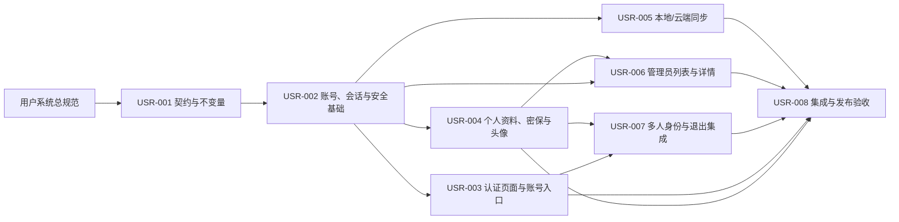

# 用户系统开发计划

本目录把[用户系统页面与交互规范](../user-system-design.md)拆成可以独立认领、评审和验收的开发 Issue。原规范仍是产品行为的总来源；本目录补充实现边界、依赖关系和验证证据，不替换原规范，也不把数据库或 API 细节重新写成另一份产品规范。

## 目标

为游客和已登录用户提供一致的账号入口、认证、安全设置、资料维护、按数据项同步和管理员账号视图，同时保持现有单人游戏、本地统计和游客多人房间可用。完成后，用户可以明确知道当前身份、数据版本和操作后果；失败、冷却、会话失效和离开房间异常都有可恢复反馈。

## 当前基线

- `apps/web/src/app/` 已有首页、游戏、统计、公告和多人页面，没有用户账号页面；`apps/web/src/app/admin/page.tsx` 是占位页。
- `apps/api/internal/handler/` 已有游客令牌鉴权、房间 REST/WS 和统一错误处理，但没有账号、密码或管理员会话。
- `contracts/openapi/openapi.yaml` 是 HTTP 契约源，`apps/api/internal/generated/` 与 `apps/web/src/generated/` 是生成输出，不得手工编辑。
- `apps/web/src/stats/` 使用 Dexie 保存本地统计，已有整体替换和合并工具；用户系统只将“整体保留一个版本”暴露给同步流程，不把现有合并能力直接作为产品操作。
- `apps/api/internal/multi/`、`apps/web/src/hooks/useRoom.ts` 和 `apps/web/src/components/RoomPage.tsx` 已实现游客房间离开及成员 `left` 状态，账号身份接入必须保留该游客路径。
- `packages/data/src/` 的角色资料包含稳定角色 ID、`firstAppearance` 和头像路径；默认头像清单尚不存在，需要在 Issue `USR-004` 中建立可发布的清单来源。

## 目标架构与数据流

认证基础是账号状态、密码和会话的权威来源；页面只展示服务端返回的状态。同步以“数据项”为边界，本地和云端冲突时服务端/同步协调层返回可比较的版本摘要，页面不得自行推断或合并。多人房间继续由现有房间状态机决定成员是否 `left`，账号退出只负责触发离开和清理本地认证状态。

## 跨 Issue 不变量

这些规则一旦由 `USR-001` 冻结，后续 Issue 不得各自改写：

- 用户名大小写敏感，`Alice` 与 `alice` 可以共存；管理员搜索大小写不敏感模糊匹配，但注册占用检查大小写精确。
- 密保答案比较前做全角/半角归一化并去首尾空格，保留大小写差异；页面不静默改写用户输入。
- UID 只含数字和大写字母，永久递增、不回收；当前上限默认 15 位，达到上限暂停注册，调整由运维完成。
- 密码、密保答案、重置授权和管理员重置凭据不写入 URL、日志、页面标题或普通详情；授权和凭据均 15 分钟有效且只能使用一次。
- 密码修改/重置会使其他设备会话失效；当前设备改密保持登录，管理员强制自己下线时当前会话也失效并回登录页。
- 失败计数和冷却由服务端决定：登录 5 次/15 分钟，密保 5 次/30 分钟，管理员敏感操作 3 次/10 分钟；刷新不能绕过，取消确认和网络错误不计数。
- 单侧数据存在时允许直接单向同步；双侧冲突只能整体保留本地或云端，不提供字段合并。冲突预览以具体变更项为主，游玩记录只给统计摘要；快照过期必须重新载入。
- 头像顺序固定为“默认头像清单顺序 + 角色首次出场时间 + 同时按稳定角色 ID”；缺失或不可用素材不显示，无效当前头像回退到第一个有效默认头像。
- 登录账号只对之后新建/加入的多人房间生效；已有游客房间不切换。退出登录先尝试离开房间，失败也完成退出并向房间显示离开及异常提示。

## Issue 清单与依赖

| Issue | 独立交付物 | 依赖 | 可并行工作 |
| --- | --- | --- | --- |
| [USR-001](USR-001-contract-and-invariants.md) | HTTP/领域契约、状态词汇、跨模块不变量和生成边界 | 无 | 作为所有后续入口 |
| [USR-002](USR-002-account-auth-session-foundation.md) | 账号、UID、密码/密保、会话、失败限制和一次性授权的服务端基础 | USR-001 | USR-003、USR-004、USR-005 可在契约稳定后并行 |
| [USR-003](USR-003-auth-pages-and-account-entry.md) | 登录、注册、忘记密码、重置密码、认证入口和退出登录页面 | USR-001、USR-002 | 可与 USR-004、USR-005 并行 |
| [USR-004](USR-004-profile-security-and-avatars.md) | 个人信息、多人名称、密保/改密设置、头像素材与解锁选择器 | USR-001、USR-002 | 可与 USR-003、USR-005 并行 |
| [USR-005](USR-005-local-cloud-sync.md) | 题库/曲库设置与游玩记录的按项同步、冲突预览和过期恢复 | USR-001、USR-002 | 可与 USR-003、USR-004 并行 |
| [USR-006](USR-006-admin-account-management.md) | 管理员账号列表、详情、搜索排序和受控维护操作 | USR-001、USR-002、USR-004 | 依赖资料展示契约后开始 |
| [USR-007](USR-007-multiplayer-identity-and-logout.md) | 账号多人身份、游客兼容、退出房间与异常广播集成 | USR-001、USR-002、USR-003、USR-004 | 在核心完成后与 USR-006 的页面实现可错峰 |
| [USR-008](USR-008-integration-accessibility-and-release.md) | 跨页面回归、可访问性、生成物、发布和回滚证据 | USR-003、USR-004、USR-005、USR-006、USR-007 | 最终收口 |

依赖图是有向无环图。`USR-003`、`USR-004`、`USR-005` 在 `USR-002` 提供可用的鉴权和数据边界后可以分成三条工作线；`USR-006` 不重新实现个人资料规则，只消费 `USR-004` 暴露的资料和头像模型；`USR-007` 不修改游客房间规则，只接入账号身份和退出编排。

## 需求归属

每项产品行为只有一个主要 Issue 负责人；跨 Issue 的页面表现由依赖 Issue 引用，不改变归属。

| 总规范行为 | 负责人 |
| --- | --- |
| 用户名匹配、密保答案归一化、UID 算法、账号状态、会话、失败限制、冷却和一次性授权 | USR-002 |
| 登录/注册/找回/重置页面、注册成功回登录、认证入口和通用退出登录入口 | USR-003 |
| 个人资料、多人游戏使用名称、密保/修改密码设置、头像初始选择/排序/解锁/失效回退 | USR-004 |
| 单向同步、整体覆盖、差异摘要、统计摘要、冲突过期重新载入 | USR-005 |
| 管理员列表搜索/排序、详情、清除密保、重置凭据、强制下线及二次确认（含管理员本人） | USR-006 |
| 新多人房间账号身份、游客房间不切换、退出登录时离开房间和成员离开提示 | USR-007 |
| 跨页面响应式、键盘/读屏、生成物检查、上线/回滚证据 | USR-008 |

## 完成定义

本计划完成须同时满足：所有 Issue 的验收标准均有证据；总规范中的入口、认证、资料、安全、同步、管理员和多人退出流程形成闭环；现有游客单人/多人功能无回归；OpenAPI/SQLC/前端生成物由生成命令更新且无漂移；发布闸门全部通过并记录环境、版本和回滚点。

实现期间不得把生产账号、初始管理员凭据、密码或密保答案加入仓库。若发布需要灰度开关，默认保持现有游客流程可用，关闭开关应能回退到未接入账号的入口，不删除数据库中的历史账号或本地统计。

## 阅读顺序

先阅读[决策记录](decisions.md)了解不可重新讨论的选择，再按依赖图阅读 Issue。发布前使用[发布闸门](release-gate.md)收集证据。原始产品语义始终以[用户系统页面与交互规范](../user-system-design.md)为准。
